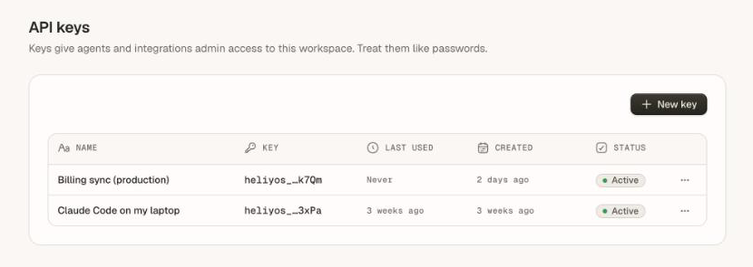
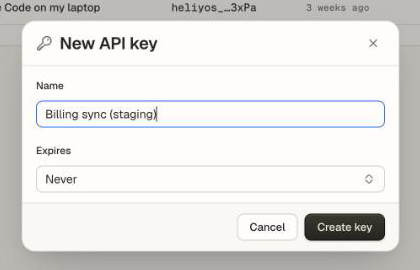

Every request to the Heliyos API carries a workspace API key as a bearer token:

```bash
curl https://api-prod.heliyos.ai/v1/platform/organization \
  -H "Authorization: Bearer heliyos_..."
```

Requests go over HTTPS to `https://api-prod.heliyos.ai`. Plain HTTP is not accepted.

## What a key can do

| | |
| --- | --- |
| **Scope** | One workspace: the one the key was created in. A key never sees another workspace. |
| **Access** | Admin access in that workspace. It can read and change records, notes, tasks, Scouts, workers, files and settings. |
| **Who can create one** | Workspace owners and admins. |
| **Lifetime** | Until its expiry date (if you set one) or until it is revoked. |
| **Owner checks** | A key keeps working only while the person who created it is active and still an owner or admin. Removing or demoting that person disables their keys. |

A few account actions are not available to API keys and answer `403 FORBIDDEN_ACTION`: managing API keys themselves, and some team changes. Each endpoint's page says when this applies.

## Create a key

<Steps>
  <Step title="Open the API keys settings">
    In Heliyos, go to **Settings → API keys**.

    <Frame>
      
    </Frame>
  </Step>
  <Step title="Name the key">
    Click **New key**. Give it a name that says where it runs, such as "Billing sync (production)" or "Claude Code on Priya's laptop". Names are up to 64 characters.
  </Step>
  <Step title="Set an expiry">
    Pick an expiry for anything that is not a long-running integration.

    <Frame>
      
    </Frame>
  </Step>
  <Step title="Copy the key">
    Click **Create key** and copy it. It starts with `heliyos_` and is **shown once**. Heliyos stores only a hash of it, so nobody, including Heliyos support, can show it to you again. If you lose it, revoke it and create another.
  </Step>
</Steps>

## Keep keys safe

<Warning>
  A key has admin access to your workspace. Treat it like a password: never commit it to a repository, paste it into a ticket or ship it in a browser or mobile app.
</Warning>

- **One key per system and person.** Separate keys let you revoke one without breaking the others, and the list shows when each was last used.
- **Store keys in a secret manager** or environment variables, never in source code.
- **Set an expiry** on keys for scripts, trials and laptops.
- **Call the API from your servers only.** The API is not meant to be called from a browser with a key.

## Rotate a key

1. Create a new key with a clear name.
2. Deploy it to the system that uses the old one.
3. Confirm requests succeed with the new key.
4. Revoke the old key in **Settings → API keys**. Revocation takes effect right away. Removing or demoting the key's creator takes effect within about a minute.

## Errors

| Status | Code | Meaning |
| --- | --- | --- |
| `401` | `UNAUTHENTICATED` | No key, a malformed key, or a key that is revoked, expired or whose creator lost access. |
| `403` | `FORBIDDEN_ACTION` | The key is valid but the action is not allowed: the endpoint does not accept API keys, or the workspace plan does not include it. |
| `429` | `RATE_LIMITED` | Too many requests. See [Rate limits](/api-reference/rate-limits). |

Repeated requests with keys Heliyos does not recognise are limited to 20 a minute per IP address.
