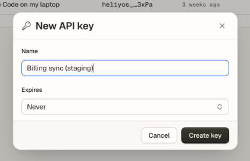

This guide takes about five minutes. You need a Heliyos workspace where you are an owner or admin.

<Steps>
  <Step title="Create an API key">
    In Heliyos, open **Settings → API keys** and click **New key**. Name it after where it will run, set an expiry if you want one, then click **Create key** and copy the key. It starts with `heliyos_` and is shown once.

    <Frame caption="Settings → API keys → New key. Name it after where it will run.">
      
    </Frame>

    Keep it in an environment variable rather than in code:

    ```bash
    export HELIYOS_API_KEY="heliyos_..."
    ```

    See [Authentication](/authentication) for what a key can do and how to rotate it.
  </Step>

  <Step title="Check the key">
    Every request sends the key as a bearer token. Read your workspace:

    ```bash
    curl https://api-prod.heliyos.ai/v1/platform/organization \
      -H "Authorization: Bearer $HELIYOS_API_KEY"
    ```

    A `200` with your workspace's name means the key works. A `401` means the key is wrong, expired or revoked.
  </Step>

  <Step title="Find the companies object">
    Records belong to an **object** (companies, people, deals or a custom object). List the objects and note the `id` of the one whose `objectType` is `company`:

    ```bash
    curl https://api-prod.heliyos.ai/v1/platform/base-schemas \
      -H "Authorization: Bearer $HELIYOS_API_KEY"
    ```

    ```json Response (trimmed)
    {
      "meta": {
        "message": "Schemas retrieved successfully"
      },
      "data": [
        {
          "id": "66a0f1e2d3c4b5a697880001",
          "name": "Company",
          "objectType": "company"
        },
        {
          "id": "66a0f1e2d3c4b5a697880002",
          "name": "People",
          "objectType": "people"
        },
        {
          "id": "66a0f1e2d3c4b5a697880003",
          "name": "Deals",
          "objectType": "deals"
        }
      ]
    }
    ```
  </Step>

  <Step title="List companies">
    Use that id to list the first page of companies, newest first:

    ```bash
    curl "https://api-prod.heliyos.ai/v1/platform/base-schemas/66a0f1e2d3c4b5a697880001/records?limit=10" \
      -H "Authorization: Bearer $HELIYOS_API_KEY"
    ```

    When `meta.pagination.next_cursor` is present, send it back as `cursor` for the next page. See [Pagination](/api-reference/pagination).
  </Step>

  <Step title="Write a note on a company">
    Take a company's `_id` from the list and link a note to it. The note shows on the company's timeline, and workers read it as customer memory.

    ```bash
    curl https://api-prod.heliyos.ai/v1/platform/notes \
      -H "Authorization: Bearer $HELIYOS_API_KEY" \
      -H "Content-Type: application/json" \
      -d '{
        "title": "Intro call",
        "content": "Interested in the Q1 pilot. Follow up with pricing.",
        "relationships": [
          {
            "objectId": "<company id>",
            "schemaId": "66a0f1e2d3c4b5a697880001",
            "objectType": "company"
          }
        ]
      }'
    ```
  </Step>
</Steps>

## Next steps

<CardGroup cols={2}>
  <Card title="Core concepts" icon="/icons/book.svg" href="/concepts/workspace-and-objects">
    How objects, records, fields, the timeline and workers fit together.
  </Card>
  <Card title="API reference" icon="/icons/api.svg" href="/api-reference/introduction">
    Every endpoint, parameter and response, with a playground.
  </Card>
  <Card title="Connect an AI agent" icon="/icons/plug.svg" href="/mcp/install">
    Use the same key with the Heliyos MCP server in Claude, Cursor or Codex.
  </Card>
  <Card title="Handle errors" icon="/icons/alert.svg" href="/api-reference/errors">
    Error codes, retries and rate limits.
  </Card>
</CardGroup>
